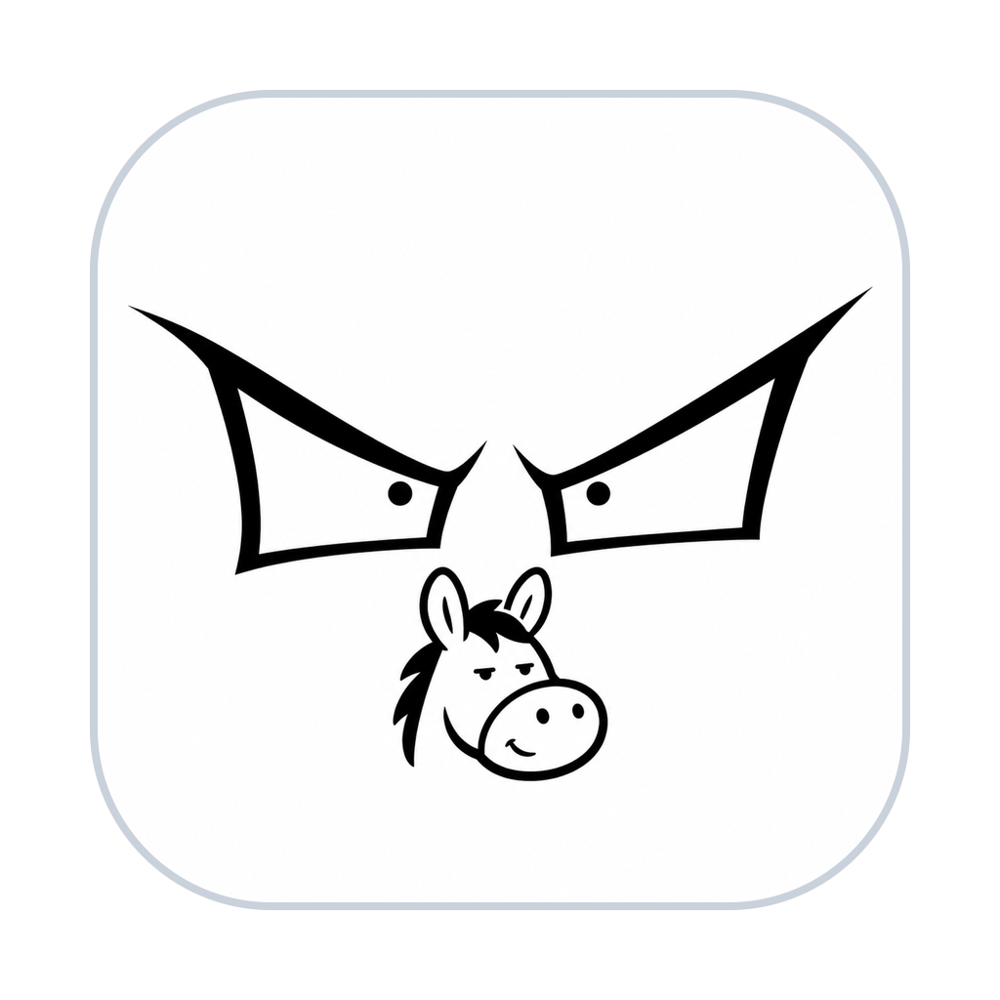
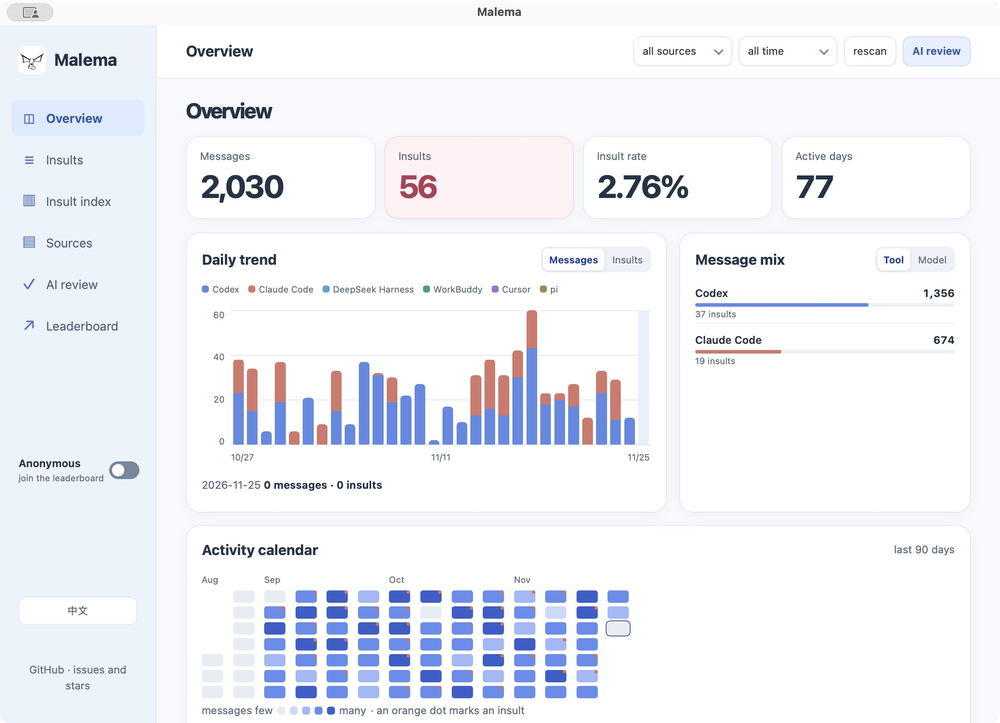

<p align="center">
  
</p>

<h1 align="center">Malema · 骂了吗</h1>

<p align="center"><a href="README.zh-CN.md">简体中文</a></p>

<p align="center">Ever wondered how often you swear at your AI coding tools? Malema tallies it up on your Mac.</p>



## Get the app

1. On a Mac with Apple silicon, download [`malema-macos-arm64.zip`](https://github.com/ay27/malema/releases/latest/download/malema-macos-arm64.zip).
2. Unzip it, drag **骂了吗.app** into Applications, and open it. The first scan starts automatically.
3. Use the date and tool filters in **Overview** to explore your stats. Switch between English and Chinese from the sidebar.

You can also install the same app with Homebrew.

```sh
brew tap ay27/malema https://github.com/ay27/malema
brew install --cask ay27/malema/malema
```

## View the leaderboard

Open **Leaderboard** in the app or visit [malema.app](https://malema.app). The all-time board ranks tool and model pairs by insults per 1,000 messages. Filter by message language, tool, or model.

New installs share counts by tool, model, and language from the first launch onward. You can turn off **Anonymous** in the app at any time. The leaderboard never receives your message text.

[MIT License](LICENSE)
