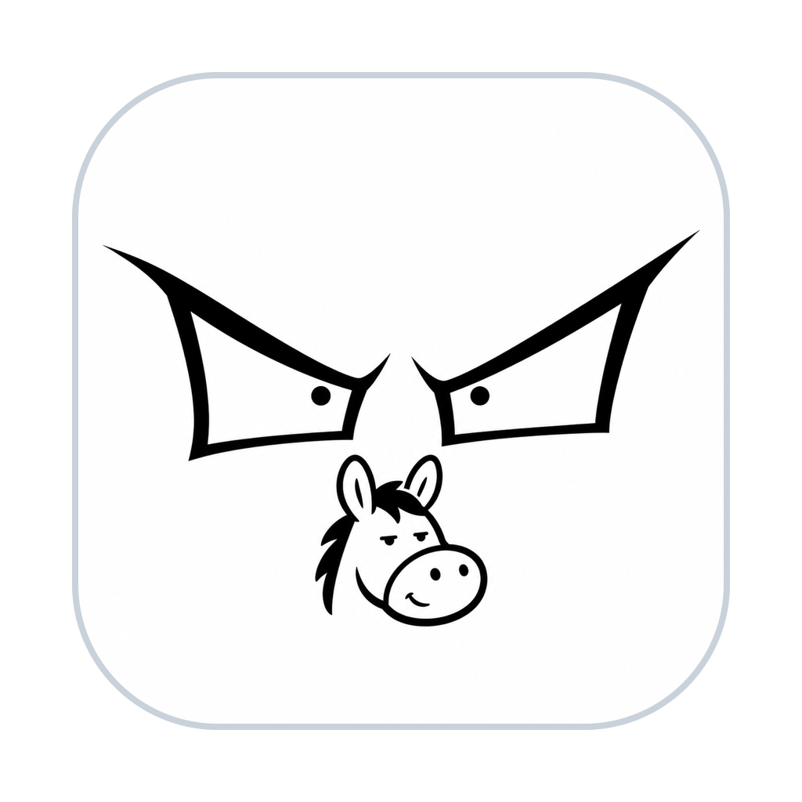

<p align="center">
  
</p>

<h1 align="center">骂了吗 · Malema</h1>

<p align="center"><a href="README.md">English</a></p>

<p align="center">平时写代码，你到底骂了 AI 多少次？打开「骂了吗」，在 Mac 上就能看到。</p>


## 怎么用

1. 在搭载 Apple 芯片的 Mac 上，下载 [`malema-macos-arm64.zip`](https://github.com/ay27/malema/releases/latest/download/malema-macos-arm64.zip)。
2. 解压，把 **骂了吗** 拖进「应用程序」，双击打开。英文系统里会显示为 **Malema**。首次打开会自动扫描。
3. 在「总览」里按日期和工具筛选，看看最近哪天骂得最多。侧栏可以切换中英文。

也可以用 Homebrew 安装同一个正式版。

```sh
brew tap ay27/malema https://github.com/ay27/malema
brew install --cask ay27/malema/malema
```

## 怎么看榜单

在 App 里点「全球榜单」，或打开 [malema.app](https://malema.app)。官网首屏是模型榜，同一个模型跨运行工具累加计数，再按每千条消息的挨骂次数排名。往下可以看模型与工具的组合榜、固定工具比较模型、固定模型比较工具。每个榜单都能独立筛选消息语言。

新安装默认开启「匿名提交」，分享本地全量计数，包含历史记录和已保存的 AI 复核结论。你可以随时关闭。模型别名在本地归一为公开名称，无法识别的计入「其他模型」。聊天原文不会发给榜单。

[MIT 许可证](LICENSE)
