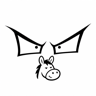
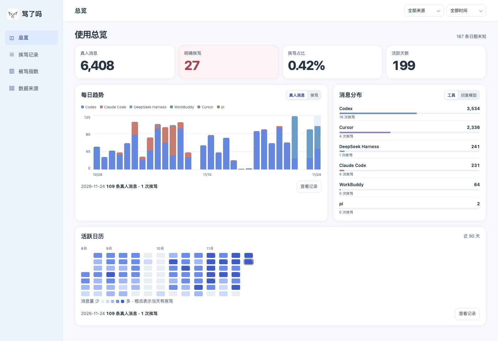

# 骂了吗 · Malema

[English](README.md)

平时写代码，你到底骂了 AI 多少次？打开「骂了吗」，在 Mac 上就能看到。

## 怎么用

1. 在搭载 Apple 芯片的 Mac 上，下载 [`malema-macos-arm64.zip`](https://github.com/ay27/malema/releases/latest/download/malema-macos-arm64.zip)。
2. 解压，把 **骂了吗.app** 拖进「应用程序」，双击打开。首次打开会自动扫描。
3. 在「总览」里按日期和工具筛选，看看最近哪天骂得最多。侧栏可以切换中英文。

## 怎么看榜单

在 App 里点「全球榜单」，或打开 [malema.app](https://malema.app)。可以按期次、消息语言、工具和模型筛选，看看每千条消息里，各个组合挨了几次骂。

默认关闭上报。想参与时，在 App 里打开「匿名提交」，分享按工具、模型和语言汇总的计数。聊天原文不会发给榜单。

[MIT 许可证](LICENSE)
